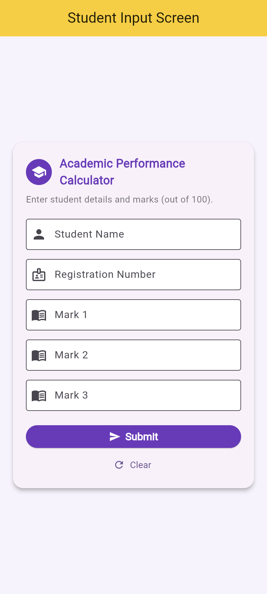
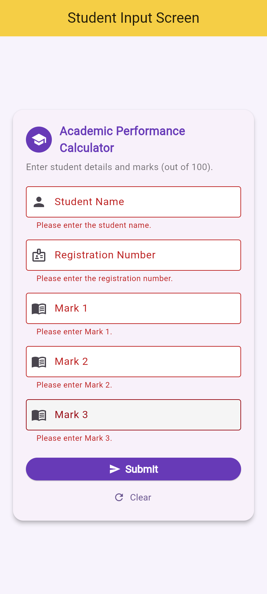
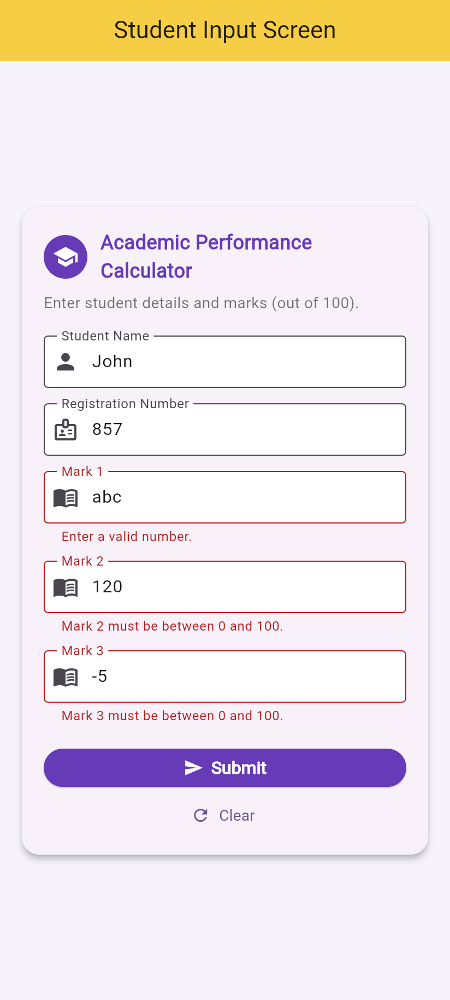
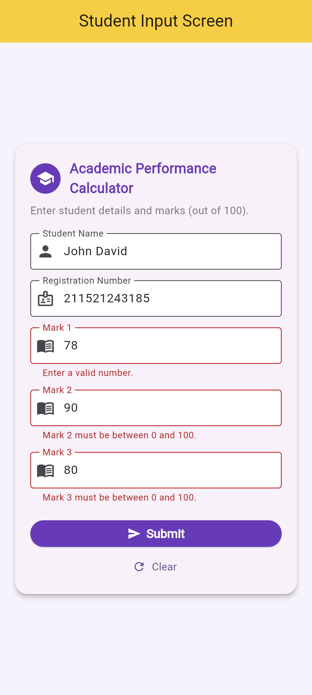
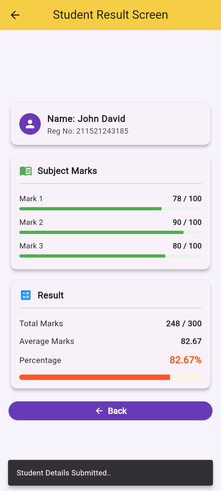
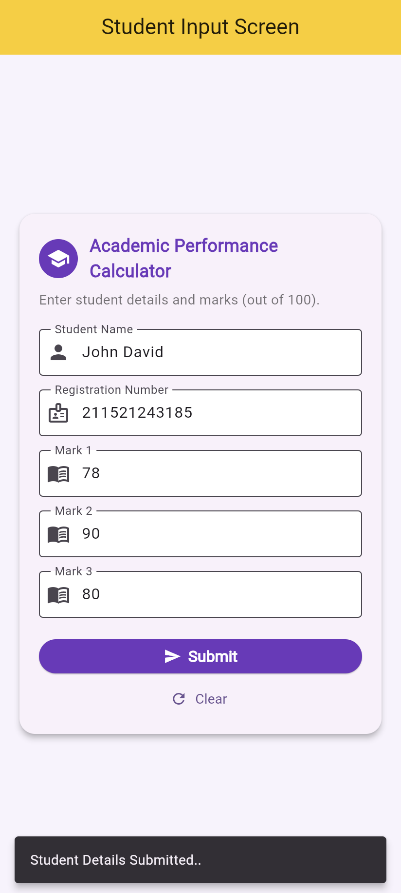
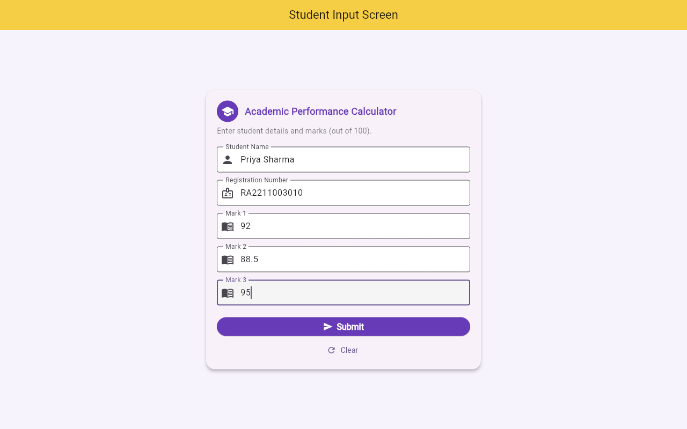
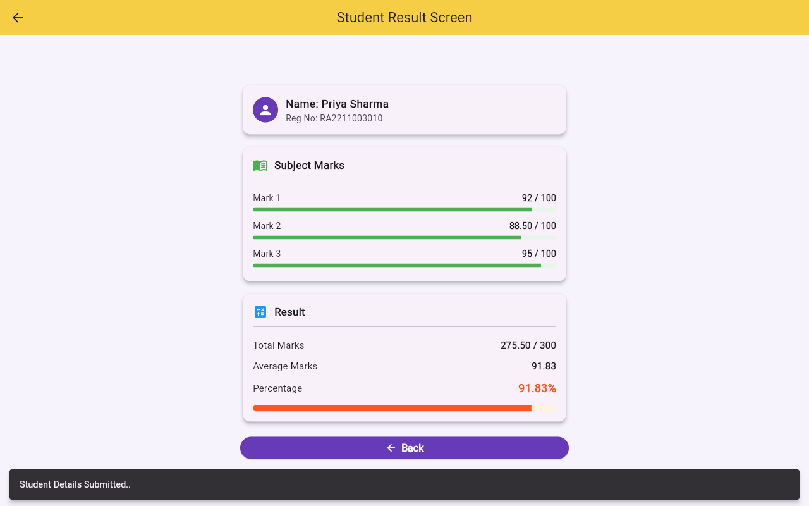

# Experiment 5 – Implementation of Navigation and Routing

**Application:** Student Academic Performance Calculator 🎓

## Aim
Develop a two-screen Flutter application that collects a student's details on an
input screen, passes them to a result screen using **named routes** and
**route arguments**, and calculates the student's Total, Average and Percentage.

## Screens

| Screen | Route | File | Purpose |
|---|---|---|---|
| Student Input Screen | `/` | [`lib/home_screen.dart`](lib/home_screen.dart) | Form with Name, Registration Number, Mark 1–3 and a Submit button |
| Student Result Screen | `/second` | [`lib/second_screen.dart`](lib/second_screen.dart) | Shows the student details, each mark, Total, Average and Percentage, with a Back button |

## Formulas

```
Total Marks   = Mark 1 + Mark 2 + Mark 3            (out of 300)
Average Marks = Total / 3
Percentage    = (Total / 300) × 100
```

## Flutter concepts demonstrated (from the reference PDF)

| Concept | Where |
|---|---|
| `MaterialApp` with `initialRoute: '/'` and a `routes` table | [`lib/main.dart`](lib/main.dart) |
| Data model class `User` | [`lib/user_data_model.dart`](lib/user_data_model.dart) |
| `StatefulWidget`, `Form`, `GlobalKey<FormState>`, `TextFormField`, `TextEditingController` | [`lib/home_screen.dart`](lib/home_screen.dart) |
| `Navigator.pushNamed(context, '/second', arguments: user)` | `_submit()` in `home_screen.dart` |
| `ModalRoute.of(context)!.settings.arguments as User` | `build()` in `second_screen.dart` |
| `Navigator.pop(context)` | Back button in `second_screen.dart` |
| `Card`, `ListTile`, `SnackBar`, `LinearProgressIndicator` | both screens |

Both screens use the yellow `Colors.amberAccent` AppBar and the
`Colors.deepPurple` button from the reference PDF.

## Validation rules

| Field | Rule | Error message |
|---|---|---|
| Student Name | required, letters/spaces only | `Please enter the student name.` / `Name can contain only letters and spaces.` |
| Registration Number | required, letters and digits only | `Please enter the registration number.` / `Use letters and digits only (no spaces).` |
| Mark 1–3 | required | `Please enter Mark N.` |
| Mark 1–3 | must be a number | `Enter a valid number.` |
| Mark 1–3 | 0 ≤ mark ≤ 100 (decimals allowed) | `Mark N must be between 0 and 100.` |

Navigation to the result screen happens **only** when every field is valid.

## Project structure

```
flutter-experiment-5-navigation-and-routing/
├── lib/
│   ├── main.dart              # MaterialApp + named routes
│   ├── home_screen.dart       # Screen 1 – Student Input Screen (form)
│   ├── second_screen.dart     # Screen 2 – Student Result Screen
│   └── user_data_model.dart   # User data model + calculations
├── test/
│   └── widget_test.dart       # validation, navigation and data-passing tests
├── screenshots/               # output screenshots from Chrome
├── android/  ios/  web/       # platform folders
├── analysis_options.yaml
├── pubspec.yaml
└── README.md
```

## How to run

```bash
flutter pub get
flutter analyze
flutter test
flutter run -d chrome
```

Tested with **Flutter 3.47.9 (stable) / Dart 3.13.7**.

## Test results

`flutter analyze` → **No issues found!**
`flutter test` → **All 9 tests passed** ([`test/widget_test.dart`](test/widget_test.dart))

| # | Test | Input | Expected | Result |
|---|---|---|---|---|
| 1 | Calculations (unit) | 78, 90, 80 | Total 248, Average 82.67, Percentage 82.67 | ✅ |
| 2 | Initial route | app start | Opens Student Input Screen (`/`) with 5 fields | ✅ |
| 3 | Empty fields | all blank | 5 "Please enter …" errors, no navigation | ✅ |
| 4 | Invalid marks | `abc`, `120`, `-5` | "Enter a valid number." / "must be between 0 and 100", no navigation | ✅ |
| 5 | Invalid name / reg no | `123`, `AB 12` | name and reg-no errors, no navigation | ✅ |
| 6 | Boundary marks | 0, 100, 100 | accepted → 200 / 300, 66.67% | ✅ |
| 7 | Navigation + data passing | John, 211521243185, 78, 90, 80 | `/second` opens, all values shown, argument is a `User` | ✅ |
| 8 | Back button | tap **Back** | `Navigator.pop()` returns to input screen, form data kept | ✅ |
| 9 | AppBar back arrow | tap ← | returns to input screen | ✅ |

The same flows were also checked by hand in Chrome (`flutter run -d chrome`).
The URL changes from `localhost:8085/` to `localhost:8085/#/second` on Submit and
back to `/` after **Back**.

## Output screenshots (Chrome)

| 1. Input screen | 2. Empty-field validation | 3. Invalid marks |
|---|---|---|
|  |  |  |

| 4. Valid details entered | 5. Result screen | 6. Back to input screen |
|---|---|---|
|  |  |  |

| 7. Desktop – input (decimal mark) | 8. Desktop – result |
|---|---|
|  |  |

## Upload to GitHub

1. Create an empty repository named `flutter-experiment-5-navigation-and-routing`
   on GitHub (do not add a README or .gitignore).
2. From inside this project folder, run:

```bash
git remote add origin https://github.com/<your-username>/flutter-experiment-5-navigation-and-routing.git
git branch -M main
git push -u origin main
```
